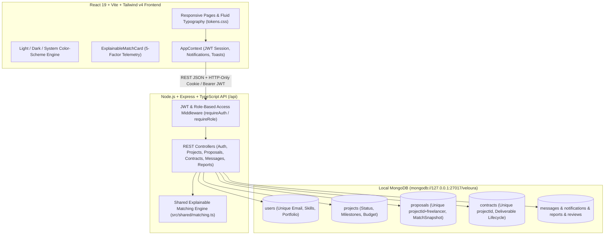

# VELOURA — Art-Directed Freelance Marketplace & Explainable Matching Engine

Veloura is a startup-grade, full-stack freelance marketplace engineered with **React 19**, **TypeScript**, **Tailwind CSS v4**, **Express**, and **Local MongoDB (`mongoose`)**. It combines a deliberate editorial typography system (**Space Grotesk**, **Inter**, and **DM Serif Display**) with a deterministic, explainable 5-factor skill-matching engine and concurrency-safe contract workflows.

---

## 1. Key Features Implemented & Verified

- **Premium Fluid Typography System**:
  - **Space Grotesk** for display headlines, page titles, section headers, and `tabular-nums` financial/match statistics.
  - **Inter** for high-legibility body copy (`text-wrap: pretty`), navigation, forms, and interactive controls.
  - **DM Serif Display** for restrained editorial contrast on the marketing homepage.
  - Fluid `clamp()` sizing across all 8 typographic tiers (`--text-hero` through `--text-label`) with `font-size-adjust: from-font` to prevent layout shift.
- **Persistent Light / Dark / System Theme Engine**:
  - Uses `<meta name="color-scheme" content="light dark">`, native CSS `light-dark()` tokens with `@media (prefers-color-scheme: dark)` fallbacks, and an interactive **Light / Dark / System** selector with zero Flash of Un-themed Content (FOUC).
- **Role-Aware Authentication & Onboarding (Local MongoDB + JWT)**:
  - Separate permissions and workspaces for **Clients**, **Freelancers**, and **Trust Admins**.
  - Interactive skill matrix editor, hourly rate calibration, and portfolio case study builder persisted in MongoDB.
- **Explainable 5-Factor Skill-Matching Algorithm**:
  - Every brief and proposal displays both the composite match score (`0–100%`) and the 5 contributing factors with natural-language explanations.
- **Concurrency-Safe Proposal Acceptance & Contract Lifecycle**:
  - Atomic conditional MongoDB transitions (`findOneAndUpdate({ _id, status: 'open' })`) prevent race conditions or double-acceptance.
  - Full lifecycle: **Publish Brief → Submit Proposal → Shortlist / Accept → Activate Contract → Submit Deliverables → Approve & Release Escrow + Publish Verified Review**.
- **Authorized Stakeholder Messaging, Notifications & Trust Moderation**:
  - Project messaging channels restricted strictly to the project client and proposing/assigned freelancers.
  - Real-time persistent notifications and an Admin Trust & Safety report moderation console.

---

## 2. System Architecture Diagram



---

## 3. Explainable Skill-Matching Algorithm (`src/shared/matching.ts`)

Every match score (`0–100` points) is deterministically calculated from five auditable dimensions:

| Factor | Max Points | Calculation Logic |
|---|---:|---|
| **1. Skill Architecture Overlap** | `40 pts` | Normalizes required project skills against the freelancer's verified skills and portfolio tags (handling synonyms such as `react.js` ↔ `react`, `tailwind` ↔ `tailwindcss`), computing $\text{round}\left(\frac{|\text{Matched}|}{|\text{Required}|} \times 40\right)$ and listing exact matched and missing skills. |
| **2. Budget & Rate Calibration** | `20 pts` | Compares the freelancer's proposed bid (or estimated sprint cost from `hourlyRate` × sprint duration) against the project's `[budgetMin, budgetMax]` band. |
| **3. Seniority & Verified Track Record** | `15 pts` | Evaluates the freelancer's seniority rank (`mid`, `senior`, `principal`), years of experience, and verified star rating against the brief's required experience tier. |
| **4. Portfolio & Domain Proof** | `15 pts` | Inspects published portfolio case studies for direct category alignment and overlapping technical tags. |
| **5. Bandwidth & Delivery Reliability** | `10 pts` | Combines current availability status (`available` = 6, `part-time` = 4, `busy` = 1) with historical contract completion rate (`completionRate`). |

**Match Tiers**:
- **85–100%**: `Exceptional Match`
- **70–84%**: `Strong Match`
- **55–69%**: `Balanced Match`
- **< 55%**: `Exploratory Match`

---

## 4. Environment Variables (`.env`)

Copy `.env.example` to `.env`:

```ini
PORT=5000
NODE_ENV=development
MONGODB_URI=mongodb://127.0.0.1:27017/veloura
MONGODB_TEST_URI=mongodb://127.0.0.1:27017/veloura_test
JWT_SECRET=veloura-local-jwt-secret-key-2026-secure
CLIENT_ORIGIN=http://localhost:5000
```

---

## 5. Local Setup, Database Seeding & Commands

Ensure your local **MongoDB** service is running on `127.0.0.1:27017`.

```bash
# 1. Install dependencies
npm install

# 2. Synchronize MongoDB collection indexes
npm run db:migrate

# 3. Seed curated demo data (Clients, Freelancers, Admin, Projects, Proposals, Contracts)
npm run db:seed

# 4. Start the full-stack development server (Express API + Vite HMR on http://localhost:5000)
npm run dev
```

### Pre-Seeded Demo Accounts (One-Click Login Available on `/auth`)
- **Client Account**: `client@veloura.dev` / `Password123!` (Elena Rostova — VP of Product Architecture)
- **Freelancer Account**: `freelancer@veloura.dev` / `Password123!` (Soren Lindqvist — Principal Design Systems Architect)
- **Trust Admin Account**: `admin@veloura.dev` / `Password123!` (Aria Chen — Head of Marketplace Trust)

---

## 6. Build, Type-Check & Automated Testing

```bash
# Run full-stack TypeScript verification
npm run typecheck

# Run automated integration test suite against local MongoDB (veloura_test)
npm test

# Build production client bundle (dist/client) and server bundle (dist/server)
npm run build

# Run production server
npm start
```

---

## 7. Deployment Instructions (Render)

1. Push the repository to GitHub.
2. In the **Render Dashboard**, click **New + → Blueprint** and connect the repository (uses the included `render.yaml`), or create a **Web Service**:
   - **Build Command**: `npm install && npm run build`
   - **Start Command**: `npm start`
   - **Health Check Path**: `/api/health`
3. Configure the environment variables in Render:
   - `NODE_ENV=production`
   - `MONGODB_URI=<your-mongodb-connection-string>`
   - `JWT_SECRET=<auto-generated-strong-secret>`
