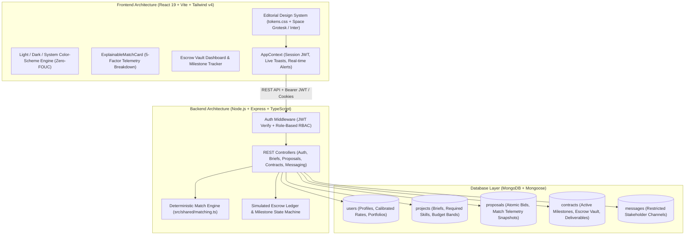

<div align="center">

  

  <h1 align="center" style="font-size: 2.8rem; font-weight: 800; letter-spacing: 0.15em; margin-top: 12px; margin-bottom: 4px;">
    VELOURA
  </h1>

  <p align="center" style="font-size: 1.15rem; font-style: italic; color: #f43f5e; margin-bottom: 16px;">
    Where Exceptional Talent Meets Visionary Capital
  </p>

  <p align="center">
    <strong>A startup-grade, art-directed freelance marketplace & deterministic matching engine.</strong><br />
    Engineered with React 19, TypeScript, Tailwind CSS v4, Express, and MongoDB.
  </p>

  <p align="center">
    <a href="#-system-architecture"></a>
    <a href="https://react.dev"></a>
    <a href="https://www.typescriptlang.org"></a>
    <a href="https://tailwindcss.com"></a>
    <a href="https://expressjs.com"></a>
    <a href="https://www.mongodb.com"></a>
    <a href="https://vitest.dev"></a>
    
  </p>

  <p align="center">
    <a href="#-quick-start">Quick Start</a> •
    <a href="#-explainable-matching-engine">Matching Engine</a> •
    <a href="#-key-features">Features</a> •
    <a href="#-demo-credentials">Demo Accounts</a> •
    <a href="#-api-reference">API Reference</a> •
    <a href="#-deployment">Deployment</a>
  </p>

</div>

---

## ✦ Overview

**Veloura** is an editorial-grade, full-stack talent marketplace designed for high-stakes creative and technical engagements. Rather than black-box AI rankings, Veloura pairs an **explainable 5-factor mathematical matching engine** with **concurrency-safe escrow workflows**, an art-directed **fluid typography system**, and persistent **Light, Dark, and System theme synchronization**.

```
Client Publishes Brief  ──►  Explainable 5-Factor Score  ──►  Milestone Escrow Contract  ──►  Release & Verified Review
```

---

## ✦ System Architecture



---

## ✦ Explainable Matching Engine

Veloura rejects opaque algorithms. Every project brief and specialist proposal generates a deterministic **0–100 match score** calculated from five transparent dimensions:

```math
\text{Total Match Score} = S_{\text{skills}} + B_{\text{budget}} + E_{\text{seniority}} + P_{\text{portfolio}} + A_{\text{bandwidth}}
```

| Factor | Weight | Evaluation Logic |
|---|:---:|---|
| **1. Skill Architecture Overlap** | **40 pts** | Computes normalized intersection between required brief tags and verified specialist skills, automatically mapping canonical synonyms (`react.js` ↔ `react`, `tailwind` ↔ `tailwindcss`). |
| **2. Budget & Rate Calibration** | **20 pts** | Evaluates proposal quote against project budget bounds $[B_{\min}, B_{\max}]$. Grants full score when within optimal range with smooth decay for under- or over-bids. |
| **3. Seniority & Track Record** | **15 pts** | Compares candidate seniority tier (`Mid`, `Senior`, `Principal`) and historical client satisfaction rating ($0.0 - 5.0\bigstar$) against brief expectations. |
| **4. Portfolio & Domain Proof** | **15 pts** | Analyzes live case studies in specialist portfolio for industry domain tags and demonstrated deliverable depth. |
| **5. Bandwidth & Reliability** | **10 pts** | Factors active availability status (`available` = 6, `part-time` = 4, `busy` = 1) and historical contract completion percentage. |

### Classification Tiers
- 🟢 **85 – 100%** · `Exceptional Match` (Immediate shortlist recommendation)
- 🔵 **70 – 84%** · `Strong Match` (Meets all critical criteria)
- 🟡 **55 – 69%** · `Balanced Match` (Good fit with minor skill/rate deltas)
- ⚪ **< 55%** · `Exploratory Match` (Requires scope or budget calibration)

---

## ✦ Key Features

### 1. Editorial Typography & Fluid Design System
- **Space Grotesk**: Editorial headlines, metrics, and tabular financial figures.
- **Inter**: High-legibility body typography (`text-wrap: pretty`), form inputs, and controls.
- **DM Serif Display**: Subtle classical contrast on marketing heroes.
- **Fluid clamp() Scaling**: Responsive text sizing from mobile to ultra-wide without layout shifts.

### 2. Zero-FOUC Theme Engine
- Native CSS `light-dark()` tokens paired with `@media (prefers-color-scheme: dark)`.
- Synchronized theme dropdown (**Light**, **Dark**, or **System**) stored in `localStorage`.
- Zero flash of unstyled content on hard refresh or initial page load.

### 3. Concurrency-Safe Contract Lifecycle
- Atomic MongoDB state transitions prevent double-acceptance or race conditions:
  $$\text{Brief} \longrightarrow \text{Proposal} \longrightarrow \text{Fund Escrow} \longrightarrow \text{Submit Work} \longrightarrow \text{Release Escrow} \longrightarrow \text{Verified Review}$$

### 4. Client & Specialist Workspaces
- **Client Suite**: Create briefs with interactive skill taggers, inspect proposal breakdown telemetry, manage milestones, and release escrow deposits.
- **Specialist Suite**: Search briefs with real-time match indicators, submit custom milestone schedules, manage portfolio case studies, and track revenue ledger.
- **Trust & Moderation Console**: Administrative review dashboard for dispute resolution, user reports, and platform audits.

---

## ✦ Quick Start

### Prerequisites
- **Node.js** v20.x or higher
- **npm** v10.x or higher
- **Local MongoDB** running on `mongodb://127.0.0.1:27017` (or a MongoDB Atlas connection string)

### 1. Clone the Repository
```bash
git clone https://github.com/harshi329/Veloura-freelancer-website.git
cd Veloura-freelancer-website
```

### 2. Configure Environment
Copy the sample environment file:
```bash
cp .env.example .env
```

Verify your `.env` settings:
```ini
PORT=5000
NODE_ENV=development
MONGODB_URI=mongodb://127.0.0.1:27017/veloura
MONGODB_TEST_URI=mongodb://127.0.0.1:27017/veloura_test
JWT_SECRET=your-random-32-char-secret-do-not-use-in-production
CLIENT_ORIGIN=http://localhost:5000
APP_URL=http://localhost:5000
SEED_DEMO_DATA=false
```

### 3. Install & Seed Database
```bash
# Install dependencies
npm install

# Initialize MongoDB collection indexes
npm run db:migrate

# Seed curated marketplace test data (optional)
npm run db:seed
```

### 4. Launch Development Server
```bash
npm run dev
```
Open **[http://localhost:5000](http://localhost:5000)** in your browser.

---

## ✦ Demo Credentials

When seeded via `npm run db:seed`, the following accounts are pre-configured for instant testing:

| Role | Email | Password | Persona |
|---|---|---|---|
| **Client** | `client@veloura.dev` | `Password123!` | Elena Rostova · VP of Product Architecture |
| **Specialist** | `freelancer@veloura.dev` | `Password123!` | Soren Lindqvist · Principal Design Systems Architect |
| **Trust Admin** | `admin@veloura.dev` | `Password123!` | Aria Chen · Head of Marketplace Trust |

> **Note**: Demo seeding is automatically restricted to non-production environments unless `SEED_DEMO_DATA=true` is explicitly set.

---

## ✦ Project Structure

```
Veloura/
├── public/                     # Static assets, logos, and brand emblems
│   ├── images/                 # High-resolution crest, wordmark, and architectures
│   └── favicon.ico
├── src/
│   ├── client/                 # React 19 Frontend
│   │   ├── components/         # Reusable UI, BrandLogo, ThemeSelector, Modals
│   │   │   └── dashboard/      # Contracts, Proposals, Projects, Payments, Settings
│   │   ├── context/            # AppContext (Auth state, API fetcher, toasts)
│   │   ├── pages/              # AuthPage, HomePage, DashboardPage, FreelancersPage
│   │   └── styles/             # tokens.css (Fluid typography & color variables)
│   ├── server/                 # Express REST API
│   │   ├── db/                 # MongoDB connection, migrations, and seed scripts
│   │   ├── middleware/         # JWT verification & role-based RBAC
│   │   ├── models/             # Mongoose schemas (User, Project, Proposal, Contract)
│   │   └── routes/             # API route controllers
│   └── shared/                 # Isomorphic types & 5-Factor matching engine
├── tests/                      # Automated Vitest integration suite
├── package.json
├── render.yaml                 # Infrastructure-as-code deployment blueprint
├── tsconfig.json
└── vite.config.ts
```

---

## ✦ API Reference

| Method | Endpoint | Access | Purpose |
|---|---|---|---|
| `POST` | `/api/auth/register` | Public | Create client or specialist account |
| `POST` | `/api/auth/login` | Public | Authenticate with credentials & receive JWT |
| `GET` | `/api/auth/me` | Authenticated | Retrieve current user profile & permissions |
| `GET` | `/api/projects` | Public / Auth | List and filter active project briefs |
| `POST` | `/api/projects` | Client | Publish a new structured project brief |
| `POST` | `/api/projects/:id/proposals` | Specialist | Submit milestone proposal with price & timeline |
| `POST` | `/api/proposals/:id/accept` | Client | Accept proposal & atomically generate contract |
| `GET` | `/api/contracts/:id` | Stakeholders | Fetch contract, deliverable status & escrow ledger |
| `POST` | `/api/contracts/:id/release` | Client | Approve deliverable and release escrow milestone |
| `GET` | `/api/health` | Public | Service health check |

---

## ✦ Quality & Testing

```bash
# Full-stack TypeScript typecheck (0 errors)
npm run typecheck

# Automated test suite (15 integration & unit tests)
npm test

# Build production client and server bundles
npm run build
```

---

## ✦ Deployment (Render / Cloud)

This repository includes a production-ready [`render.yaml`](./render.yaml) blueprint:

1. Connect your repository to [Render](https://render.com).
2. Create a **Web Service** or use the **Blueprint** workflow:
   - **Build Command**: `npm install && npm run build`
   - **Start Command**: `npm start`
   - **Health Check Path**: `/api/health`
3. Supply required environment variables:
   - `NODE_ENV=production`
   - `MONGODB_URI=<your-mongodb-atlas-url>`
   - `JWT_SECRET=<strong-random-32+-char-secret>`
   - `CLIENT_ORIGIN=https://<your-service>.onrender.com`
   - `APP_URL=https://<your-service>.onrender.com`

---

## ✦ License

Distributed under the **MIT License**. See `LICENSE` for more information.

<div align="center">
  <sub>Crafted with passion for the future of specialized independent work. © Veloura.</sub>
</div>
